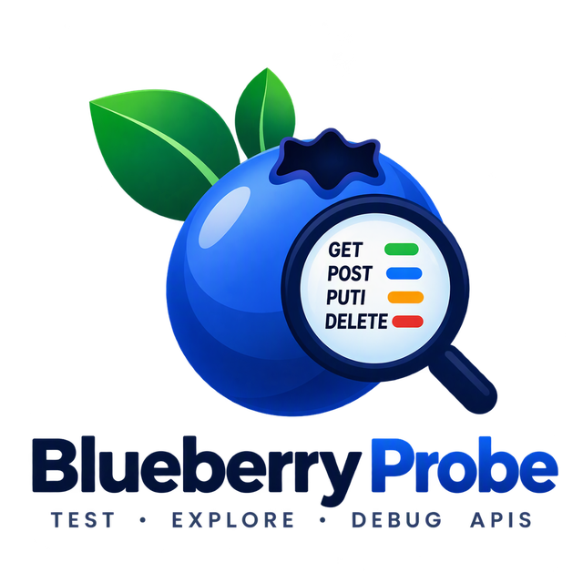

# Blueberry Probe

<p align="center"></p>

Blueberry Probe is a local, single-user web tool for test-running HTTP requests against customer systems. It is built with Blazor Server on .NET 10 and runs only on your own machine. Security is the first priority.

It is a lightweight alternative to Postman for a team that mostly works against one family of systems (styled APIs with session cookies and CSRF tokens), with a simple cookie model, flows, assertions and importers for existing collections.

## Features

- **Workspace:** build and send requests (any HTTP method, query parameters, headers, auth, body), view status, timing, size, headers and body of the response, and copy the request as cURL.
- **Bodies:** raw (JSON, XML, text), form URL-encoded, multipart with file upload, and binary. See [File uploads](docs/user/en/file-uploads.md).
- **Auth:** none, bearer, basic and OAuth client credentials.
- **Collections and folders:** save, organise and search requests.
- **Environments and variables:** `{{variable}}` placeholders, secret variables, an optional Base URL, allowed hosts and a production flag. The Base URL is also available as `{{baseUrl}}`.
- **Session cookies:** paste the whole `Cookie` header from your browser once per environment. It is stored encrypted and sent automatically to the environment's host. A built-in profile and an automatic CSRF token are available. See [Cookie and CSRF login](docs/user/en/cookie-csrf-login.md).
- **Flows:** run other requests before a request, extract values from responses (JSON path, header, cookie) into variables, and run a collection as a sequence.
- **Assertions:** check status, headers, body content and JSON values on each response.
- **History:** recent requests without secrets or response bodies.
- **Import and export:**
  - Postman collections and environments as JSON or YAML, including Postman's multi-file YAML format.
  - `.http` / `.rest` files and cURL commands.
  - Zip archives containing many files (up to 5000 files; limits below). Folder structure is kept.
  - Export as `.http` and Postman collection JSON.
  - Everything that cannot be translated, such as scripts, is listed in an import report. Scripts are never executed.
- **Built-in help:** user documentation under `docs/user/en`, shown in the app.
- **Design:** a "Precision light" interface with a collapsible left rail, light and dark themes, a command palette (`Ctrl+K`) and keyboard shortcuts (`Ctrl+Enter` sends).

## Security model

The hard rules apply to every change (details in [`AGENTS.md`](AGENTS.md) and the [security rules skill](.github/skills/security-rules/SKILL.md)):

1. Kestrel binds to loopback only, and `AllowedHosts` is `localhost;127.0.0.1`. A guard middleware checks host and origin ([ADR 0005](docs/decisions/0005-local-guard.md)).
2. Secrets are write-only in the UI, resolved server-side when a request is sent, stored with OS protection (Windows DPAPI) and never written to logs, history or exports.
3. `Authorization`, `Cookie` and `Set-Cookie` are never logged or put in history. Response bodies are not stored by default. Session cookies are the one deliberate exception: they are stored encrypted per environment ([ADR 0007](docs/decisions/0007-session-cookies.md)).
4. TLS certificate validation is on by default. Ignoring errors is an explicit setting per environment.
5. Production environments require confirmation before POST, PUT, PATCH and DELETE.
6. No real customer URLs, tokens or data in code, docs, tests or fixtures. Use `example.test` hosts and fake tokens.

Imports are read in memory and never executed. Zip imports reject unsafe paths and nested archives, and enforce limits while reading.

## Requirements

- Windows (secret protection uses DPAPI; see [ADR 0004](docs/decisions/0004-storage.md)).
- [.NET 10 SDK](https://dotnet.microsoft.com/download).

## Getting started

```powershell
dotnet build ProbeDesk.slnx
dotnet run --project src/ProbeDesk.Web
```

The console prints the address. Open http://127.0.0.1:5187 in your browser.

Then:

1. Open **Environments**, create an environment and set its **Base URL**.
2. Open **Cookies** and paste the `Cookie` header from your browser (optional but typical for these systems). Use **Test session** to verify it.
3. Send requests from the **Workspace**, or bring existing ones in via **Import**.

The in-app **Help** page covers these steps in more detail.

### Importing a Postman export

- **JSON or YAML collection (v2.1) or environment:** choose *Postman* and pick the file or paste its content.
- **Multi-file YAML export** (a folder with `.resources/definition.yaml` and one `*.request.yaml` per request): zip the exported folder and import the zip. Saved response examples (`*.example.yaml`) are skipped.
- **Several files at once:** choose *Zip archive*. Each file is detected automatically and merged into one review report. You save once.

| Zip limit | Value |
|---|---|
| Files per archive | 5000 |
| Size per file | 5 MB |
| Unpacked total | 25 MB |
| Zip upload | 10 MB |

## Where data is stored

Everything stays on your machine, outside the repository:

- `%LOCALAPPDATA%\ProbeDesk\` holds the SQLite database (`probedesk.db`) with collections, environments, history and encrypted secrets.
- The folder name and file name keep the old product name on purpose to avoid orphaning existing data.

## Configuration

`src/ProbeDesk.Web/appsettings.json`:

| Key | Default | Meaning |
|---|---|---|
| `ProbeDesk:Port` | `5187` | Loopback port Kestrel listens on |
| `AllowedHosts` | `localhost;127.0.0.1` | Hosts accepted by the app |

## Development

| Task | Command |
|---|---|
| Build | `dotnet build ProbeDesk.slnx` |
| Test all | `dotnet test ProbeDesk.slnx` |
| Test one project | `dotnet test tests/ProbeDesk.Core.Tests` |
| Test one case | `dotnet test tests/ProbeDesk.Core.Tests --filter "FullyQualifiedName~FlowTests.SomeTestName"` |
| Run | `dotnet run --project src/ProbeDesk.Web` |

No linter is configured.

If the app is running, it locks its output files. Build or test the Web project into another folder with `-p:OutDir=C:\Temp\build\` in that case.

### Solution layout

```
src/
  ProbeDesk.Web      Blazor UI, DI, Kestrel, guard middleware
  ProbeDesk.Core     HTTP engine, model, variables, extractors, assertions, flow runner
  ProbeDesk.Import   Postman, .http and cURL importers, exporters, import report, zip/YAML handling
  ProbeDesk.Storage  EF Core + SQLite, secret protection (DPAPI)
tests/               xUnit tests per project
docs/
  decisions/         Architecture decision records (ADRs)
  user/en/           In-app help pages (English)
.github/             Copilot instructions and project skills
```

Dependencies point one way: `Web` -> `Core`, `Import`, `Storage`; `Import` -> `Core`; `Storage` -> `Core`; `Core` references nothing internal and stays free of UI and storage code. See the [architecture skill](.github/skills/architecture/SKILL.md).

### Conventions

- Code, identifiers, commit messages, repo docs and the UI are in English.
- The HTTP method is a string. Use `HttpCompletionOption.ResponseHeadersRead` and honor `CancellationToken`.
- Importers never execute scripts and must report everything they do not translate. Test fixtures use invented data only.
- UI: use CSS variables from `src/ProbeDesk.Web/wwwroot/tokens.css`, never hard-coded colors. Keep visible focus states and support both light and dark themes. See the [UI design system skill](.github/skills/ui-design-system/SKILL.md).
- Significant decisions are recorded in `docs/decisions/`. Update affected skills, `AGENTS.md` and in-app help in the same change.
- Before finishing a change, go through the [definition of done](.github/skills/definition-of-done/SKILL.md).

### Known v1 deviations

- `EnsureCreated` is used instead of EF migrations ([ADR 0004](docs/decisions/0004-storage.md)).
- Secret protection is Windows-only (DPAPI).
- No Monaco editor and no MudBlazor ([ADR 0006](docs/decisions/0006-no-monaco.md)).

## Architecture decisions

| ADR | Topic |
|---|---|
| [0001](docs/decisions/0001-plan.md) | Plan and milestones |
| [0003](docs/decisions/0003-http-flavor.md) | HTTP flavor |
| [0004](docs/decisions/0004-storage.md) | Storage |
| [0005](docs/decisions/0005-local-guard.md) | Local guard (loopback, host/origin checks) |
| [0006](docs/decisions/0006-no-monaco.md) | No Monaco editor |
| [0007](docs/decisions/0007-session-cookies.md) | Session cookies |
| [0008](docs/decisions/0008-visual-redesign.md) | Visual redesign |
| [0009](docs/decisions/0009-product-name.md) | Product name |
| [0010](docs/decisions/0010-import-yaml-zip.md) | YAML and zip import |

## Keyboard shortcuts

| Shortcut | Action |
|---|---|
| `Ctrl+Enter` | Send the request |
| `Ctrl+K` | Open the command palette |
| `Esc` | Close the command palette |

## Troubleshooting

- **Access denied in the browser:** open the app at `http://127.0.0.1:5187` (or `localhost`); other host names are rejected.
- **Port already in use:** another instance is running, or change `ProbeDesk:Port`.
- **Build fails with locked DLLs:** stop the running app, or use `-p:OutDir=` as described above.
- **"Missing variables: …" when sending:** define the variable under *Environments*. `{{baseUrl}}` comes from the environment's Base URL.
- **Test session returns 404:** the Base URL is probably not the API host. Test session calls `/api/users/me` on that host.
- **401 or 403 after a while:** the browser session expired. Paste a fresh `Cookie` header on the **Cookies** page.

## By
Mattias Dahlgren, mattias.dahlgren@outlook.com